# ☕ NgopiJongjon

> *"Seduhan nikmat & camilan hangat buat nemenin waktu santai kamu"*

**NgopiJongjon** adalah aplikasi pemesanan kopi dan camilan berbasis Android Native yang dirancang dengan estetika modern, *cozy*, dan *artisanal*. Mengusung bahasa desain bertema **Espresso & Warm Cream**, aplikasi ini memberikan pengalaman antarmuka yang bersih, responsif (mendukung orientasi *Portrait* maupun *Landscape*), serta alur navigasi pemesanan yang intuitif.

---

## ✨ Fitur Utama

1. **Onboarding & Autentikasi Pengguna**
    - **Welcome Screen:** Halaman pembuka dengan identitas visual khas NgopiJongjon.
    - **Auth Choice:** Pilihan cepat bagi pengguna untuk masuk (*Masuk*) atau membuat akun baru (*Daftar*).
    - **Login & Register:** Validasi input formulir (mengecek kolom kosong dan pencocokan kredensial pengguna) dilengkapi fitur *password visibility toggle*.
2. **Eksplorasi Menu & Filter Kategori (Home Page)**
    - Sapaan personal dinamis sesuai *username* pengguna yang sedang aktif.
    - Filter menu interaktif berdasarkan kategori: **Semua**, **Minuman**, dan **Makanan**.
    - Daftar menu menggunakan `RecyclerView` dengan informasi foto produk, deskripsi komposisi, dan harga.
    - Umpan balik instan (*Toast*) saat pengguna memilih item menu.
3. **Alur Pemesanan & Pengiriman (Order Flow)**
    - **Detail Order / Alamat:** Pengisian otomatis (*auto-fill*) nama pemesan dari sesi aktif, dilengkapi input alamat lengkap dan patokan lokasi dengan validasi form.
    - **Konfirmasi Pesanan (Order Success):** Halaman status konfirmasi bahwa pesanan sedang diproses oleh kurir dan navigasi kembali ke beranda dengan pembersihan *back stack*.
4. **Manajemen Profil & Keamanan Sesi (Profile Page)**
    - Pembaruan nama tampilan pengguna secara langsung (*real-time state update*).
    - Fitur **Keluar Akun (Logout)** dan **Keluar Aplikasi (Back Press pada Home)** yang dilengkapi dialog konfirmasi (`AlertDialog`) untuk mencegah penutupan tidak sengaja.
5. **Dukungan Penuh Mode Portrait & Landscape (Responsive UI)**
    - Tata letak adaptif menggunakan direktori `layout-land` dan `drawable-land`.
    - Transformasi navigasi bawah (*Bottom Navigation*) menjadi navigasi samping (*Side Drawer style*) saat perangkat berada dalam mode *landscape*.

---

## 🛠️ Teknologi yang Digunakan

- **Bahasa Pemrograman:** [Kotlin](https://kotlinlang.org/)
- **UI Toolkit & Layout:** XML Android Views, `ConstraintLayout` (dengan `Guideline` proporsional), `NestedScrollView`, `RecyclerView`, dan `CardView`
- **Komponen Desain:** [Material Design Components](https://m3.material.io/) (`MaterialButton`, `MaterialCardView`, `TextInputLayout`, `TextInputEditText`)
- **Manajemen Gambar:** [Glide](https://github.com/bumptech/glide) untuk pemuatan gambar menu yang efisien dan *smooth*
- **Aset Grafis:** Custom `VectorDrawable` dengan kurva *bezier* untuk latar belakang bertema *espresso* (`#1C0B03`) dan *warm cream* (`#E8CFAF`)
- **IDE:** Android Studio

---

## 📱 Screenshot Tampilan Aplikasi

### 1. Tampilan Portrait

#### A. Alur Onboarding & Autentikasi
| Welcome Screen | Pilihan Autentikasi | Halaman Daftar (Register) | Halaman Masuk (Login) |
| :---: | :---: | :---: | :---: |
| 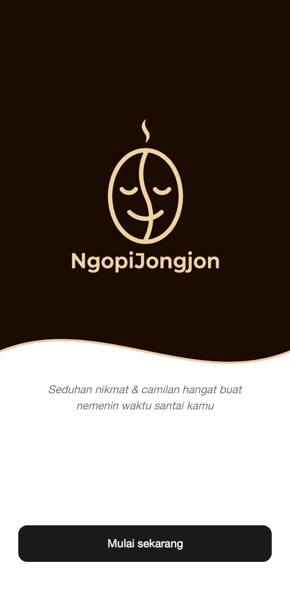 | 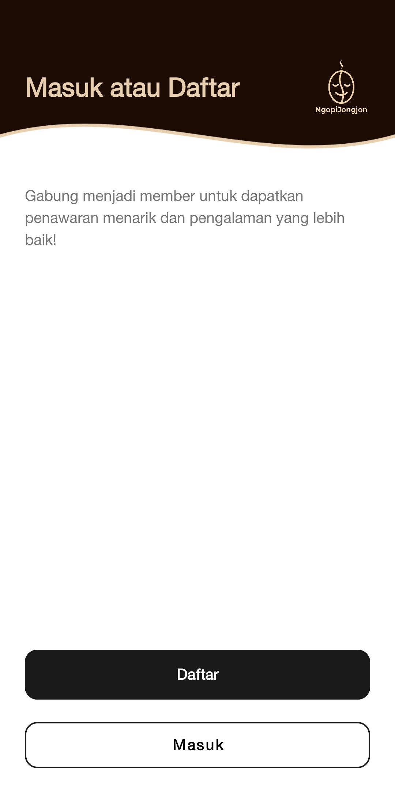 | 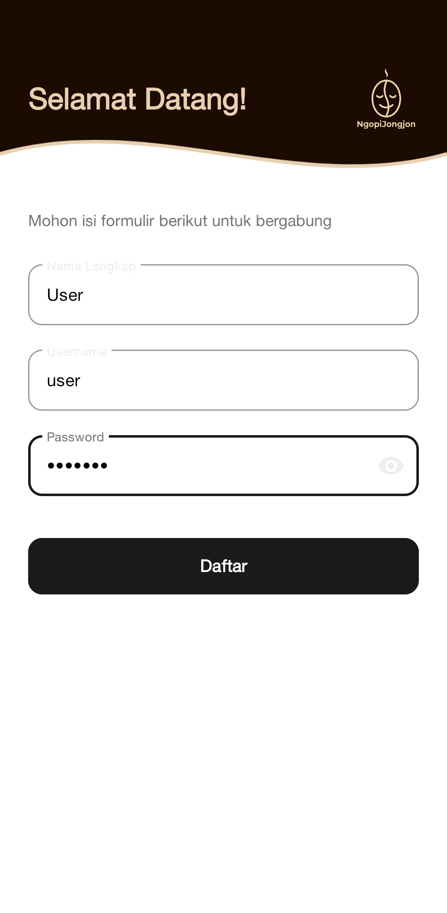 | 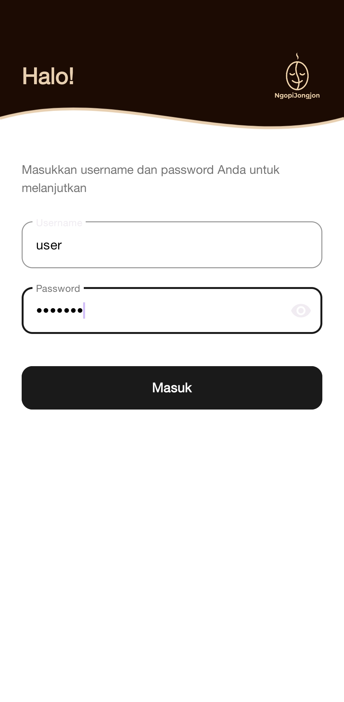 |

#### B. Halaman Utama (Home) & Filter Kategori
| Kategori: Semua | Kategori: Minuman | Kategori: Makanan | Dialog Keluar Aplikasi |
| :---: | :---: | :---: | :---: |
| 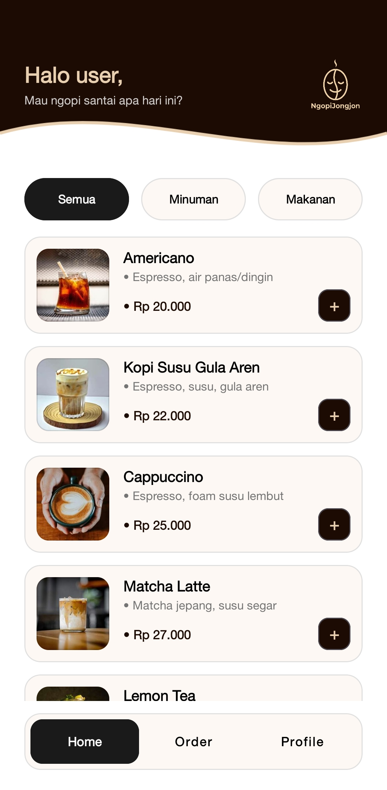 | 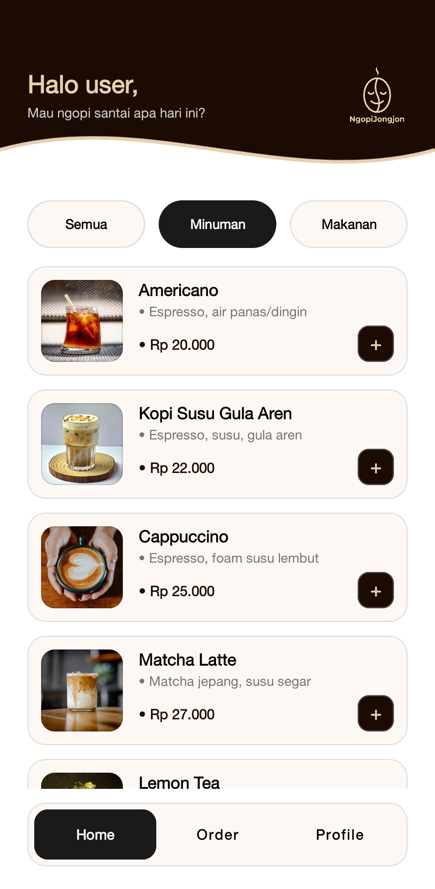 | 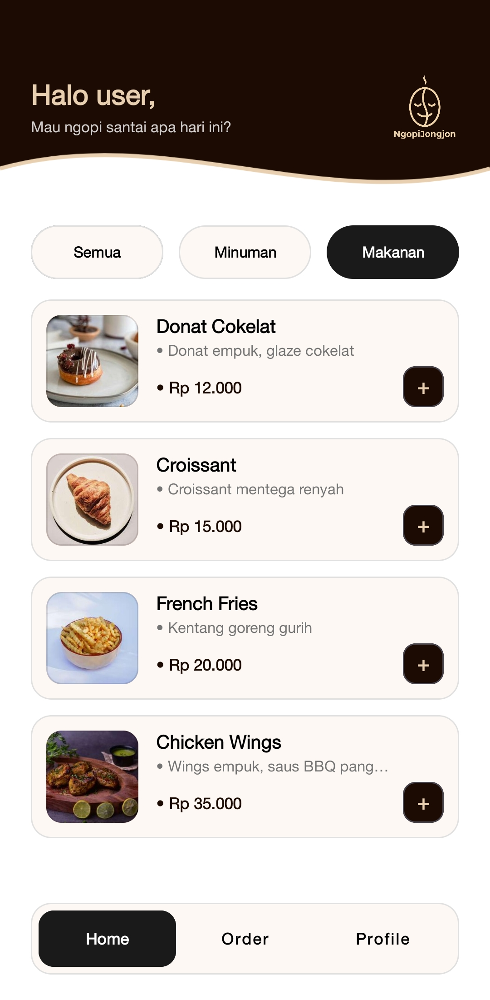 | 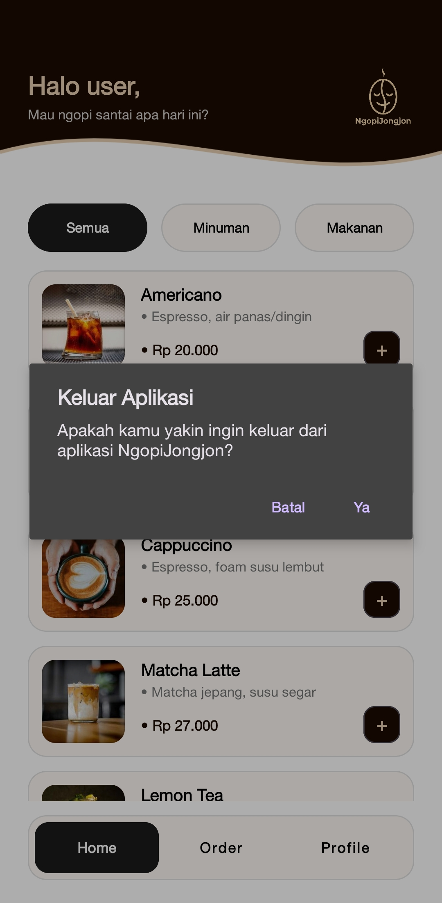 |

#### C. Alur Pemesanan (Order) & Profil Pengguna
| Form Detail Order | Konfirmasi Order Sukses | Halaman Profile | Dialog Konfirmasi Logout |
| :---: | :---: | :---: | :---: |
| 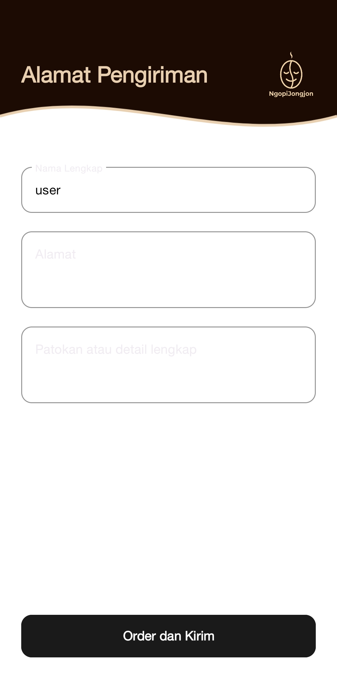 | 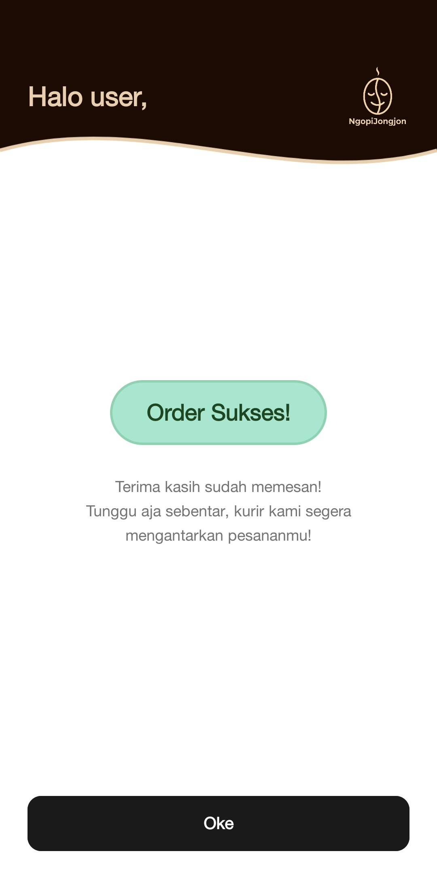 | 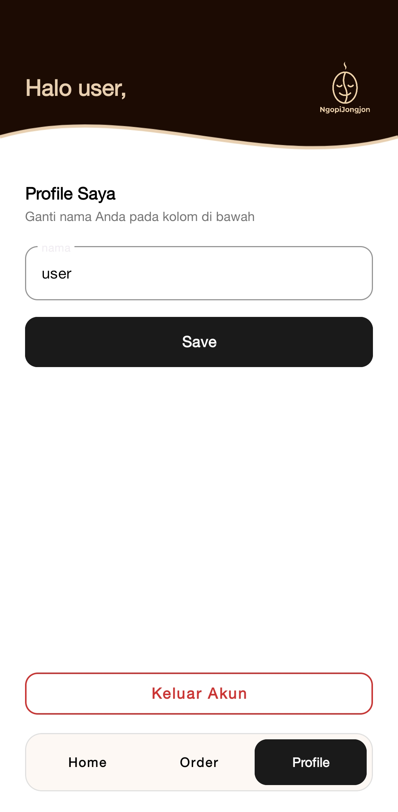 | 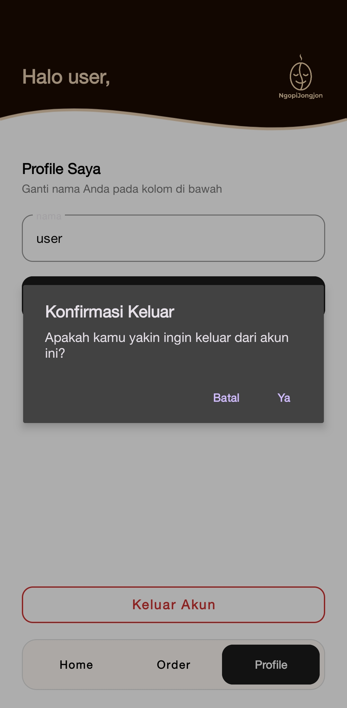 |

---

### 2. Tampilan Landscape (Responsive Layout)

| Welcome (Landscape) | Login / Register (Landscape) |
| :---: | :---: |
| 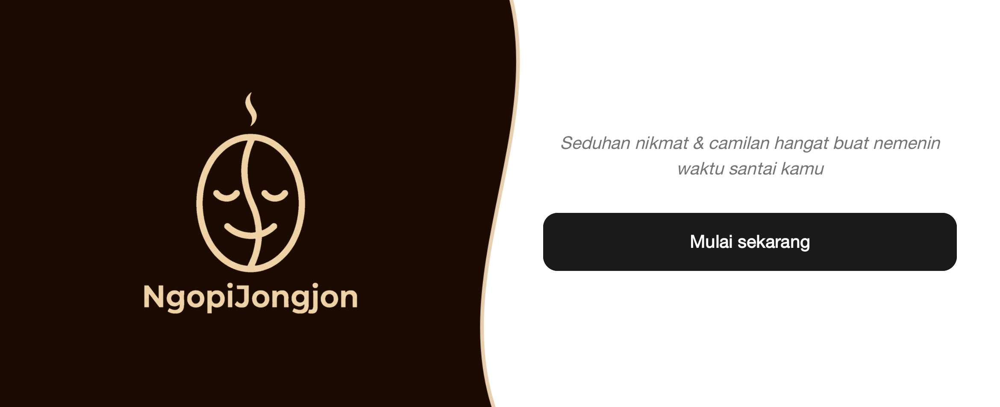 | 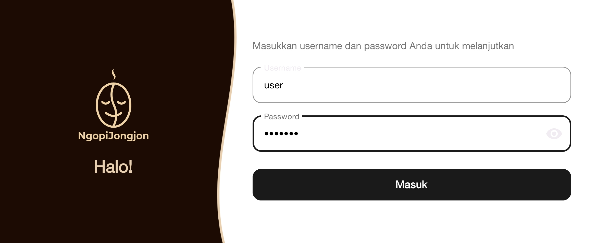 |

| Home dengan Side Nav (Landscape) | Profile / Order (Landscape) |
| :---: | :---: |
| 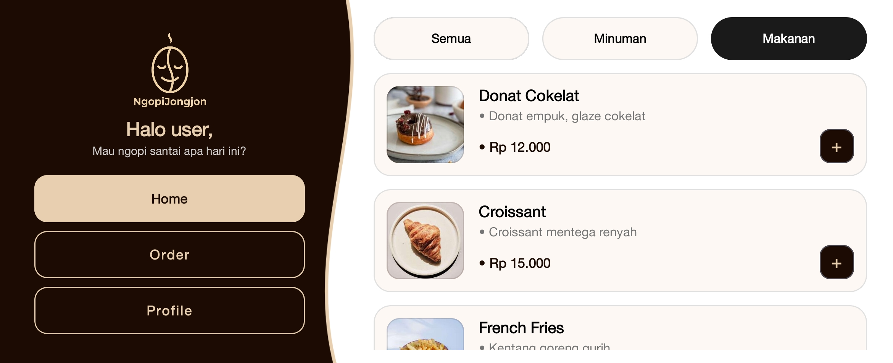 | 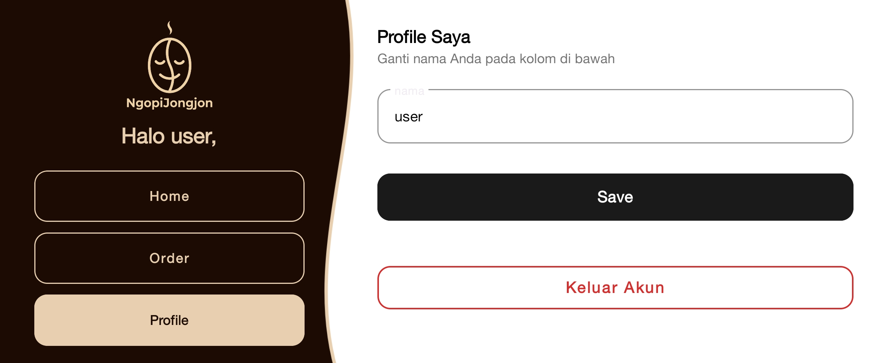 |

---

## 🚀 Cara Menjalankan Aplikasi

Ikuti langkah-langkah berikut untuk menjalankan proyek ini di perangkat lokal Anda:

### Prasyarat
- **Android Studio** (disarankan versi terbaru: Ladybug / Koala atau yang lebih baru).
- **JDK 17** atau versi yang sesuai dengan konfigurasi Gradle proyek.
- Perangkat Android fisik (mengaktifkan *USB Debugging*) atau **Android Emulator**.

### Langkah Instalasi
1. **Clone repositori ini:**
   ```bash
   git clone https://github.com/hadiial/NgopiJongjon.git
   ```

2. **Buka di Android Studio:**
    - Buka Android Studio, pilih **Open**, lalu arahkan ke direktori folder `NgopiJongjon` yang baru saja di-*clone*.

3. **Sinkronisasi Gradle:**
    - Tunggu hingga proses *Gradle Sync* selesai mengunduh seluruh dependensi (termasuk Material Components dan Glide). Jika belum berjalan otomatis, klik **File > Sync Project with Gradle Files**.

4. **Jalankan Aplikasi:**
    - Pilih target perangkat (Emulator atau HP fisik) pada *toolbar* atas.
    - Klik tombol **Run 'app'** (ikon segitiga hijau ▶️) atau tekan `Shift + F10`.

### 🔑 Akun Demo (Untuk Pengujian Login)
Untuk masuk melalui halaman **Login**, gunakan kredensial statis berikut:
- **Username:** `user`
- **Password:** `user123`

*(Catatan: Anda juga dapat menggunakan halaman **Daftar / Register** untuk langsung masuk menggunakan nama pengguna kustom pilihan Anda).*

---

## 📂 Struktur Proyek

```text
app/src/main/
├── java/lat/pam/ngopijongjon/
│   ├── WelcomeActivity.kt        # Halaman pembuka (Splash/Onboarding)
│   ├── AuthChoiceActivity.kt     # Halaman pemilihan Masuk atau Daftar
│   ├── LoginActivity.kt          # Autentikasi login pengguna
│   ├── RegisterActivity.kt       # Pendaftaran pengguna baru
│   ├── HomeActivity.kt           # Halaman katalog menu & filter kategori
│   ├── MenuAdapter.kt            # Adapter RecyclerView untuk item menu
│   ├── MenuItem.kt               # Data class model menu
│   ├── OrderAddressActivity.kt   # Form input alamat pengiriman pesanan
│   ├── OrderSuccessActivity.kt   # Halaman konfirmasi pesanan berhasil
│   └── ProfileActivity.kt        # Pengaturan nama profil & fitur logout
└── res/
    ├── drawable/                 # Aset gambar menu, ikon, & vector background portrait
    ├── drawable-land/            # Vector background khusus orientasi landscape
    ├── layout/                   # File XML antarmuka orientasi portrait
    ├── layout-land/              # File XML antarmuka orientasi landscape
    └── values/                   # Konfigurasi strings.xml, colors.xml, dan themes.xml
```

---

## 👤 Penulis

- **Salman Hadi Al Ghifari** ([@hadiial](https://github.com/hadiial))
    - Program Studi Teknik Informatika – UIN Sunan Gunung Djati Bandung